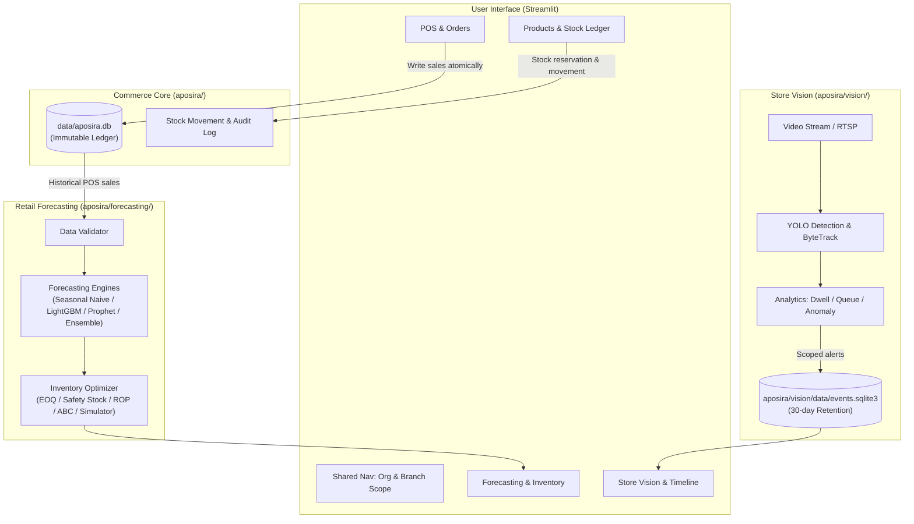

# APOSIRA Architecture & Workspace Guide

APOSIRA is an integrated retail intelligence platform combining transactional commerce, AI-driven demand forecasting, and computer-vision store surveillance into a single, unified application package.

---

## 1. Directory Structure

```text
.
├── aposira/                     # Unified APOSIRA Platform Package
│   ├── app.py                   # Streamlit unified UI & shared navigation
│   ├── commerce.py              # SQLite transactional ledger (products, orders, stock)
│   ├── ui.py                    # Shared APOSIRA design system & theme styling
│   ├── vision_events.py         # Store vision event timeline & durable acknowledgments
│   │
│   ├── forecasting/             # Demand Forecasting & Inventory Optimization
│   │   ├── backend/
│   │   │   ├── config.py        # Forecasting parameters & paths
│   │   │   ├── database.py      # SQLite connection & sample data seeder
│   │   │   ├── main.py          # Standalone FastAPI forecasting service
│   │   │   └── core/
│   │   │       ├── forecasting/ # LightGBM, Prophet, Ensemble, Quantile engines
│   │   │       ├── optimization/# EOQ, safety stock, reorder point, ABC, simulator
│   │   │       ├── pakistan_calendar.py # Local holiday & seasonal adjustments
│   │   │       └── reports.py   # PDF/Excel/CSV export generation
│   │   ├── dashboard/app.py     # Forecasting Streamlit workspace
│   │   ├── data/sample/         # Product, store, and historical sales datasets
│   │   ├── exports/             # Generated export files (.gitkeep)
│   │   ├── models/              # Trained LightGBM/Prophet model artifacts
│   │   └── train_model.py       # Training pipeline
│   │
│   └── vision/                  # Store Vision AI (Computer Vision Pipeline)
│       ├── config/              # YAML configurations (settings, zones, cameras, rules)
│       ├── dashboard/           # Vision dashboard, polygon editor & alerts panel
│       ├── main.py              # Vision pipeline entry point (RTSP/video ingestion)
│       ├── streamlit_app.py     # Vision Streamlit workspace (unified APOSIRA theme)
│       ├── src/
│       │   ├── detector/        # YOLO object detector
│       │   ├── tracker/         # ByteTrack multi-object tracker
│       │   ├── analytics/       # Dwell, queue, heatmap, pose, anomaly scorer
│       │   ├── alerts/          # Event store (30-day retention) & alert manager
│       │   ├── stream/          # Video & RTSP stream manager
│       │   └── utils/           # Face blurring, zone I/O, configuration schema
│       └── tests/               # Vision module unit & synthetic track tests
│
├── tests/                       # Root integration test suite
│   ├── conftest.py              # Pytest fixtures and repository root path setup
│   ├── test_aposira.py          # Commerce ledger, cart, order workflow tests
│   ├── test_api.py              # Forecasting API & validation tests
│   └── test_ui.py               # Streamlit UI simulation & navigation tests
│
├── docs/                        # Architecture & SRS alignment documentation
│   ├── ARCHITECTURE.md          # This system map
│   └── requirements-alignment.md# FYP SRS traceability matrix
│
├── run_aposira.py               # Main launcher (runs unified Streamlit application)
├── run_runpod.sh                # RunPod cloud deployment automation script
├── requirements.txt             # Core application dependencies
└── requirements-ml.txt          # Optional ML/Vision dependencies (YOLO, LightGBM, etc.)
```

---

## 2. Subsystem Relationships & Data Flow



---

## 3. Data Storage & Scoping

1. **Commerce DB (`data/aposira.db`)**:
   - Manages products, customers, stock movements, order lifecycle, and loyalty.
   - **Immutable Ledger**: Stock levels are computed from transaction history. No updates or deletions.
   - **Tenant Scoping**: All records are scoped by `organization_id` and `branch_id`.

2. **Vision Event Store (`aposira/vision/data/events.sqlite3`)**:
   - Persists detection events, suspicious activities, and alerts.
   - Auto-retention: Events older than 30 days are automatically purged.
   - Scoped by organization and branch.

3. **Forecasting Data (`aposira/forecasting/data/`)**:
   - Accepts POS history or CSV uploads. Requires minimum 6 months of daily records for ML forecasting.

---

## 4. Quick Commands

| Action | Command |
|---|---|
| **Run Unified App** | `python run_aposira.py` |
| **Run Full Test Suite** | `pytest -v` |
| **Run Vision Tests** | `pytest aposira/vision/tests -v` |
| **Deploy to RunPod** | `bash run_runpod.sh` |
